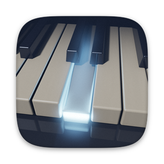
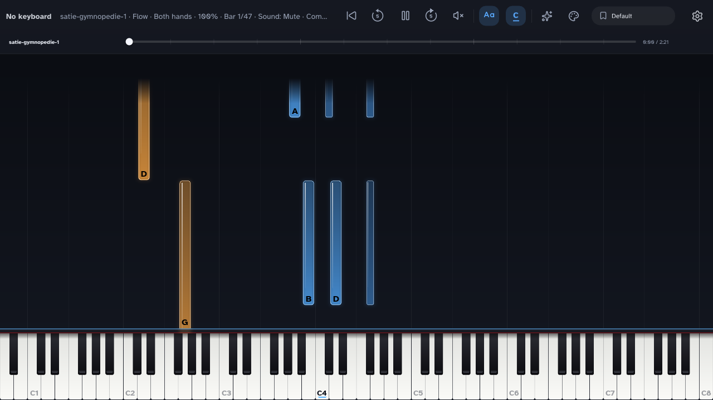

<div align="center">



<h1>toonval</h1>

**Learn piano with falling notes on a MIDI keyboard, a touch screen or your computer.**

Free and open source, built for Raspberry Pi 5 and running on macOS and Linux.


[](https://github.com/techneissa/toonval/actions/workflows/ci.yml)
[](https://github.com/techneissa/toonval/releases)
[](https://github.com/techneissa/toonval/stargazers)

<a href="https://buymeacoffee.com/techneissa"></a>
<a href="https://ko-fi.com/P3E528MZS0"></a>

</div>

---



## Features

- Live MIDI input from any USB keyboard; the key range adapts to the keyboard.
- A built-in piano sound, with low latency.
- Songs from MIDI, MusicXML (`.musicxml`, `.xml`, `.mxl`) and MuseScore (`.mscz`) files.
- Flow mode (the song keeps going and each note is graded) and Wait mode (the song waits for you).
- Practise the right hand, the left hand or both, at 25–150% speed, with A–B loops.
- Six note styles and several colour schemes, with note names as letters or solfège.
- Play without a MIDI keyboard: click or touch the on-screen keys, or type.

## Getting started

You need a C++20 compiler, CMake 3.25 or newer, [Ninja](https://ninja-build.org) and [just](https://github.com/casey/just).

- **macOS:** `xcode-select --install`, then `brew install cmake ninja just`.
- **Linux (Debian, Ubuntu, Raspberry Pi OS):** `sudo apt install build-essential cmake ninja-build pkg-config libasound2-dev libudev-dev libdrm-dev libgbm-dev libegl-dev libgles-dev libx11-dev libxext-dev libxcursor-dev libxi-dev libxfixes-dev libxrandr-dev libxss-dev libxtst-dev libwayland-dev libxkbcommon-dev wayland-protocols libdecor-0-dev`

```
just build    # configure and build everything
just run      # build and start the app
just test     # build and run the unit tests
```

The first configure downloads the dependencies, and the piano samples (148 MB, FluidR3_GM, cached once per user). To skip the samples and get a silent piano, configure with `-DTOONVAL_PIANO_FROM_SOURCE=OFF`.

## Using it

Put song files in the `Songs` folder inside the settings folder, or open one with `toonval --song FILE`.
macOS: `~/Library/Application Support/toonval/toonval/Songs`. Linux: `~/.local/share/toonval/toonval/Songs`.

| Key | Action |
| --- | --- |
| `A S D F G H J K L ; '` | White keys, C to F from middle C. `W E T Y U O P` are the black keys between. |
| `Z` / `X` | Octave down / up |
| `C` / `V` | Softer / louder |
| `Tab` | Sustain pedal |
| `Space` | Play / pause |
| `←` / `→` | Skip back / forward |
| `Home` | Replay from the start |
| `↑` / `↓` | Speed +5% / −5% |
| `[` `]` `\` | Set loop start, set loop end, clear loop |
| `1` `2` `3` | Right hand, left hand, both |
| `M` | What you hear of the song: mute, other hand, both |
| `Q` | Flow / Wait mode |
| `Page Down` / `Page Up` | Next / previous song in the Songs folder |
| `Esc` | Close the settings panel, then quit |

`toonval --help` lists the other options (looks, note styles, key size, window size, MIDI logging).

## Raspberry Pi

On Raspberry Pi OS (64-bit), run `just pi-setup`. It installs the packages, builds in Release, installs the app to `/opt/toonval`, and installs the systemd units that start it on the console. `just pi-setup --dry-run` prints the plan first. [deploy/pi/CHECKLIST.md](deploy/pi/CHECKLIST.md) lists the hardware checks.

## Roadmap

- [ ] A new settings screen and more note styles
- [ ] A song library browser
- [ ] Named sections and practice lists
- [ ] Microphone pitch detection for acoustic pianos
- [ ] A setup wizard
- [ ] Import songs from USB or a web upload page
- [ ] History and progress views
- [ ] A second screen

## Contributing and licence

See [CONTRIBUTING.md](CONTRIBUTING.md). toonval is free software under the GPL-3.0-or-later; see [LICENSE](LICENSE).

Built with [SDL3](https://libsdl.org), SDL3_ttf, [FreeType](https://freetype.org), [libremidi](https://github.com/celtera/libremidi), [Dear ImGui](https://github.com/ocornut/imgui), [pugixml](https://pugixml.org), [miniz](https://github.com/richgel999/miniz), [TinySoundFont](https://github.com/schellingb/TinySoundFont) and [doctest](https://github.com/doctest/doctest). The font is [Atkinson Hyperlegible](https://brailleinstitute.org/freefont), and the piano sound comes from [FluidR3_GM](https://musescore.org/en/handbook/3/soundfonts-and-sfz-files#list) (MIT, Frank Wen).
